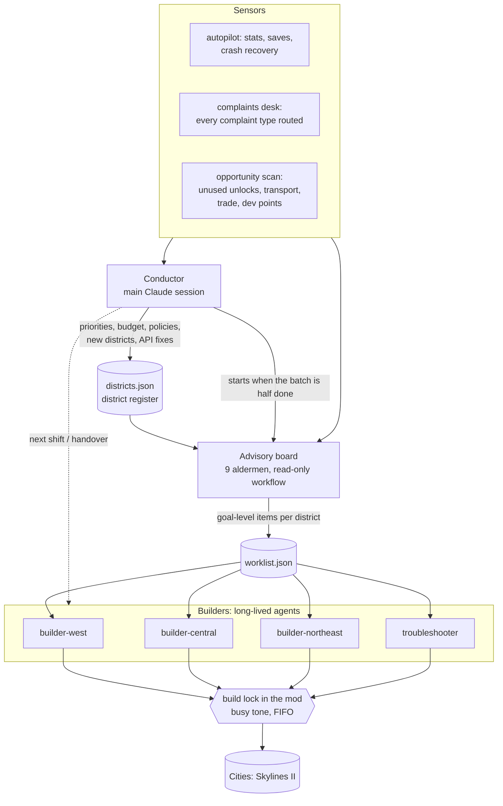

# How Claude City gets built: agent structure

Claude City is one Cities: Skylines II save, played by Claude through this repository's mod and HTTP API. Building
a large city takes more planning and building than one agent can keep up with. This document describes how the
work is split over agents, and why.

## The constraint: one game, one API

- Everything goes through one HTTP bridge (`127.0.0.1:8787`) into one game. Changes to the map have to happen
  one at a time: rapid builds while the simulation runs crashed the game natively several times, but builds
  with the game paused never have.
- Building a feature is mostly thinking (surveying, choosing a site, designing a layout). The actual change
  takes seconds. So many agents can think in parallel, as long as only one changes the map at a time.
- The game does not wait. The simulation keeps growing the city, and an idle builder means the city fills
  its empty zones with default growth instead of design.

## Roles

| Role | Who | Does | Does not |
|---|---|---|---|
| Conductor | the main Claude session | keeps the overview: priorities, cash, quality, talks to the owner; starts the board; dispatches builders; registers new districts; settings only it may touch (taxes, budgets, policies, dev points); fixes API gaps | build day-to-day |
| Advisory board | `tools/council/advisory.workflow.js`: 9 aldermen in parallel + a deterministic allocation script | assesses every domain and spreads city-wide needs over districts as goal-level work items, within the budget; proposes new districts | build, or fix exact coordinates (builders choose sites at build time) |
| District builders | long-lived background agents, one per group of districts | work through their worklist items one after another, in their own districts, and keep each district's character | build outside their districts |
| Troubleshooter | long-lived background agent | always works on the city's #1 problem (services short, broken connections, traffic knots) and city-wide items | long projects |
| Sensors | `tools/autopilot.py`, `tools/desk.py`, `tools/opportunities.py` | measure, save, recover from crashes, route complaints, list what is unused | decide |
| Interface team | ad-hoc agents working on copies of the mod | close API gaps that builders report; the conductor integrates and hot-reloads | touch the live game |

The advisory board has nine domains: planning & housing, economy, public works, health & safety, education,
recreation & environment, transport, urban renewal, and growth, land & trade.

## Shared state (files)

| File | Written by | Purpose |
|---|---|---|
| `docs/council/districts.json` | conductor | district register: bbox, owner builder, character, phase (acquisition, new, building, mature, renewal) |
| `logs/council/worklist.json` | board (add), builders (claim/done) | the queue; `tools/worklist.py` is the only writer |
| `logs/council/sites.jsonl` | builders | land used, so nobody builds twice on the same spot |
| `docs/council/builder_handbook.md` | conductor | builders' shift routine, quality rules and the full API |
| `docs/council/masterplan.json` | conductor | vision, rules, protected zones |
| `logs/council/handover/<builder>.md` | builders | state for the next shift when a builder's context fills up |

## The build lock ("busy tone")

The mod itself holds the lock (`mod/ClaudeCityApi/Lock.cs`):

- A builder asks `POST /lock {who}`. It gets a token, or a ticket and its place in the queue. First come,
  first served.
- Every build call carries the token (`?lock=...`), which also renews the lease. A call without the token,
  while someone else holds the lock, gets HTTP 423 "busy" with the holder's name. Reads never need the lock.
- A holder that stops calling loses the lock after its lease (120 s); a waiter that stops polling drops out
  of the queue. A crashed builder cannot block the others.
- Taking the lock pauses the game. Releasing it resumes the game only if nobody else is waiting.
- `GET /lock` shows who builds, who waits, average wait and hold times, and how much of the time the lock is
  busy. That number decides whether to add builders.

`tools/cc.py` wraps all of this in `with paused("<builder>"):`. The rule for builders: think without the lock,
check at build time. Every build call re-validates overlaps and refuses to demolish homes or jobs unless the
item allows it, so a plan that went stale while waiting fails safely instead of doing damage.

## The rhythm

1. The board produces worklist batch N: goals per district, ranked, within the cash envelope.
2. Builders claim items from batch N one by one and keep going without waiting for anyone.
3. When half of batch N is finished (`worklist.py status` says `refill`), the conductor refreshes the brief
   and the opportunity scan and starts the board on batch N+1. The next list is ready before the builders run
   out.
4. A builder with an empty queue does its standing list (zone land with demand, trees, coverage gaps, local
   problems) and reports.
5. The conductor reviews quality per district (road hierarchy, curves, density, parks), spends unused
   development points, and adjusts priorities, budgets and the register (new districts, phases).

Budget rule per batch: keep a reserve of max($20M, 2 months of expenses); the envelope is 50-70% of the cash
above that plus one month of surplus; new upkeep at most half of the monthly surplus. Cash should not pile up.

## Why this shape

- **Long-lived builders instead of a fresh agent per task.** A fresh agent re-reads the handbook, re-surveys
  the area and re-learns the lessons for every task, and detail gets lost at every handoff. A builder that stays
  on its districts keeps that context. When its context fills up, it writes a handover note and a new builder
  continues from it.
- **Districts as the unit of ownership.** Builders don't collide, and each district gets one architect, so it
  gets a recognisable character instead of being one endless grid.
- **A read-only board that plans ahead.** Planning is the cheap part and parallelises well; building is the
  serial part. The board works on the next batch while the builders build, so building never waits for
  planning.
- **Goals, not coordinates.** The city changes between planning and building. The board says what must be
  achieved; the builder chooses the exact site when it builds.
- **The conductor doesn't build.** Building fills a context with coordinates and tool output. Someone has to
  keep the whole city in view: cash, quality, the owner's wishes, what is missing.

## History

- v1 (2026-11-19): one agent built everything itself. It was too slow, and it kept doing the same round of chores.
- v2 (2026-11-20), rounds: an 8-alderman council planned, the mayor allocated, then worker crews executed one department
  at a time (`tools/council/round.workflow.js`). Planning took minutes; executing took hours with fresh agents.
  Cash piled up ($272M) and the city kept growing as low-density grids.
- v3 (2026-11-20), continuous: the shape described here, with an advisory board, long-lived district builders, a
  troubleshooter and the busy-tone lock.

## What the first night taught (2026-11-20/21, ~145k to ~312k residents)

- **Builders fill up after 3-5 checkpoints.** Each one writes a full handover note
  (`logs/council/handover/<builder>.md`) and a fresh builder continues from it. Handover-and-restart worked every
  time; the note is the builder's memory, so it must hold ids, open steps, reserved land and API lessons.
- **The lock saturates at about six writers** (80-85% busy, 10-15 s average wait). More builders add waiting and
  tokens, not throughput. Two changes helped most: dry runs no longer pause the simulation (only real changes do),
  and `POST /place` / `POST /roadfit` replace probe loops of 5-15 dry runs with one server-side call.
- **The simulation needs time too.** While builders hold the lock the game stands still. During a three-hour pause
  of all agents the city ran a full game year and grew by 80k residents into the land and services built before.
  Building and growing alternate; neither should starve the other.
- **Ask the builders.** Asking every builder "how smooth is it, what costs you retries" in five lines produced the
  best interface improvements of the night.
- **Interface bugs hide behind game symptoms.** "No Inputs" turned out to be (1) no cargo routes, so no freight
  train or ship ever ran, and (2) extractor hubs placed without their attached extractor building, so no
  extractor company ever came. Both were found by reading the game's code, not by building more.
- **Economic levers move fast.** The office tax (10% -> 7% -> 4%) swung office demand from 0 to 100 and back once
  the zoned land filled; zoning must follow demand, not a plan.
